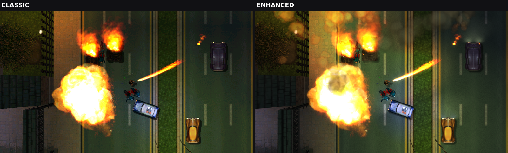

  <picture>
    <source media="(prefers-color-scheme: dark)" srcset="docs/images/reg2_logo_black.svg">
    
  </picture>

# reG2

Play GTA2 natively on Windows, Linux and macOS: the original game, rebuilt from its decompiled source,
with optional extras like smoother frame rates, better lighting and twin-stick controls.

> [!WARNING]
> **reG2 is a beta.** Expect bugs, and please report them. No multiplayer for now.

reG2 is a fork of [gta2_re](https://github.com/CriminalRETeam/gta2_re) by the CriminalRETeam, and all the
credit for the game itself goes to them: they rebuilt GTA2 (PC, version 10.5) function by function, in
C++ that compiles back to the original machine code. reG2 just adds what you need to run it today (SDL3,
OpenGL, sound, gamepads) and some extras on top.

You need your own copy of GTA2 for PC. The free 2004 release works.

## Classic or enhanced

On first start, CHOOSE YOUR STYLE asks how you want to play. CLASSIC is the game as it was in 1999:
same lighting, same controls, saves at churches only. ENHANCED turns on refined lights and shadows, the
day and night cycle, twin stick controls, autosave, job retry and frenzy respawn. Nothing is forced: every extra below
can be turned on or off later in OPTIONS (start menu, or Escape in game), one by one.

A few things differ anyway, whatever you pick:

- it runs at your screen's resolution, and a wide screen shows a bit more on the sides
- it draws a frame each time your screen refreshes, while the game itself keeps its original speed
- the settings are in the game: OPTIONS in the start menu replaces GTA2 Manager, the original's separate
  settings program, in five pages (GAME, GRAPHICS, DISPLAY, SOUND, CONTROLS), and pressing Escape during
  a game pauses it and opens the same menu, with the original pause screen's numbers under STATISTICS
- every menu works with the mouse, the keyboard or a gamepad
- a few crashes of the original are fixed, among them some the community found
  ([Vike's GTA2 11.44](https://gtamp.com/gta2/) patch, gtamp.com); the game plays the same
- no intro movie for now

## Extras

**Graphics.** GRAPHICS > PRESET switches between CLASSIC and ENHANCED: true colour, per-pixel lighting,
car headlights, light from gunfire, explosions and fires, fire effects (heat haze, smoke and embers),
ambient occlusion, soft shadows, bloom, anti-aliasing.

**Day and night.** GAME > LIGHTING > DAY-NIGHT CYCLE instead of the fixed dusk.

**Frame rate.** As fast as your screen, or a fixed limit up to 240 fps (DISPLAY > FRAME LIMIT, where
30 ORIGINAL brings back the original's rate). The game still runs at its 30 steps per second and the
frames in between are interpolated, so it plays exactly the same, just smoother.

**Controls.** CONTROLS lets you change every key, in three columns: the original keys, a second set and
the gamepad.

- **Keyboard and mouse:** the second set is ready to use: WASD to move, F to get in and out of cars,
  left click to shoot, the wheel to change weapon.
- **Gamepad:** complete, beyond the original's basic joystick: any pad plugged in, analog driving, every
  menu, its own button pictures.
- **Twin stick** (CONTROLS > TWIN STICK), in the style of Hotline Miami: move with one stick or WASD, aim
  with the other or the mouse. Shots go where you aim and the camera leads a little ahead the way you aim;
  hold Shift (LT on a pad) to look out toward the cursor. The turrets of the fire truck, tank and gun jeep aim the same way.

**And also** 3D sound, camera zoom, HUD scale, a frame rate counter. The new menus follow the game's language, as far as your
copy of the game has it.

## Saves

reG2 keeps the original church saves, one per city, and adds an optional autosave, job retry and frenzy respawn.

**Churches.** Church saves work exactly as before: same cost, and the same file the original reads. reG2
also keeps one per city, so you can go back to a city you left.

**Autosave.** GAME > AUTOSAVE saves after each job or kill frenzy and as you leave a city. A small SAVING
sign shows while it writes. When you quit from the pause menu, you choose: SAVE AND QUIT, or QUIT
without saving.

**Retry jobs.** GAME > RETRY JOBS: when a job or a kill frenzy fails, retry it from the pause menu, a few
steps from where it started, with the money you had then.

**Frenzy respawn.** GAME > FRENZY RESPAWN: a failed kill frenzy comes back on the map, like a job's phone after a
failure: its skull at once, or for a vehicle frenzy a new vehicle where the first one was parked, as soon as that spot
is clear and out of sight. A passed frenzy never comes back.

**Load game.** RESUME SAVED STATUS shows your saves with a tab per city: church save, autosave and retry,
each with its money, jobs passed and date.

AUTOSAVE, RETRY JOBS and FRENZY RESPAWN are off unless you turn them on, or pick ENHANCED. Purists can ignore all of it:
with CLASSIC, only churches save, as in the original.

## Download

| System | Download |
|---|---|
|  Windows 10 or later | [reG2-windows-x64.zip](https://github.com/reG2-project/reG2/releases/latest/download/reG2-windows-x64.zip) |
|  Linux | [reG2-x86_64.AppImage](https://github.com/reG2-project/reG2/releases/latest/download/reG2-x86_64.AppImage), or [Flatpak](https://github.com/reG2-project/reG2/releases/latest/download/reG2-x86_64.flatpak), or [tar.gz](https://github.com/reG2-project/reG2/releases/latest/download/reG2-linux-x86_64.tar.gz) |
|  macOS 11 or later (Apple Silicon and Intel) | [reG2-macos.dmg](https://github.com/reG2-project/reG2/releases/latest/download/reG2-macos.dmg) |
|  Nintendo 3DS (homebrew) | [reG2 3DS](https://github.com/reG2-project/reG2-3DS), its own repository |

All releases are on the [releases page](https://github.com/reG2-project/reG2/releases).

- **Windows:** unzip anywhere and run `reg2.exe`.
- **Linux:** the AppImage is the simplest: make it executable and run it. For the Flatpak,
  `flatpak install --user reG2-x86_64.flatpak` (needs Flathub set up). The tarball runs with `./reg2`.
  Nothing else to install: reG2 brings its own libraries and only uses the graphics, display and sound
  libraries every Linux desktop already has.
- **macOS:** untested, as I don't have a Mac: the builds come straight from GitHub's CI, so please tell
  me if it works. The app isn't signed by Apple, so the first time, right-click it and choose Open.

On first start reG2 asks for the game files: it can copy an existing GTA2 install, or install from the
free Rockstar Classics installer or the CD. Saves and settings go in your user folder: see [Where files go](#where-files-go).

## Where files go

reG2 looks for the game in `GTA2_DIR`, the current folder and its own folder, else in the per-user folder
below, where the first start copies it. Settings (`gta2_registry.ini`) and saves (`player/`) sit next to
the game data; `reG2.log` is written only after a crash or an error.

| System | Per-user folder |
|---|---|
| Windows | `%APPDATA%\reG2\` |
| Linux (AppImage, tar.gz) | `~/.local/share/reG2/` |
| Linux (Flatpak) | `~/.var/app/io.github.reG2_project.reG2/data/reG2/` |
| macOS | `~/Library/Application Support/reG2/` |

## Building

See [`port/README.md`](port/README.md). The matching build from gta2_re (MSVC 6, `build.py`) still works
as before.

## Credits

- [gta2_re](https://github.com/CriminalRETeam/gta2_re) and everyone who worked on it.
- [SDL3](https://libsdl.org), [OpenAL Soft](https://openal-soft.org).
- The logo uses the [Michroma](https://github.com/googlefonts/Michroma-font) font (OFL).

Grand Theft Auto and GTA2 are trademarks of Take-Two Interactive. Not affiliated with Rockstar Games or
Take-Two. No game data included.
